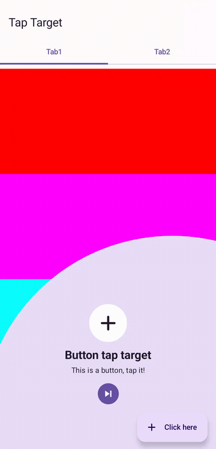
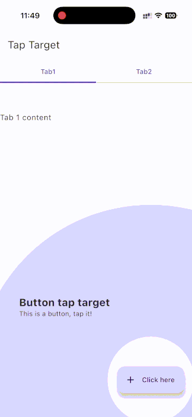

<!-- Replace .github/tap-target-cmp.svg with your project icon. -->
<p align="center">
  
</p>

# tap-target-cmp

Animated feature-discovery overlays for Android and iOS, built with Compose Multiplatform.

[](https://central.sonatype.com/artifact/zone.ien.taptargetcmp/taptarget)
[](LICENSE)

**English** | [한국어](README_ko.md)

## Overview

`tap-target-cmp` introduces app features by highlighting an existing composable and displaying a title and description beside it. Wrap a screen in a coordinator, mark its targets with a modifier, and let the library handle ordered presentation, overlay animations, and scrolling requests.

This fork of [tap-target-compose](https://github.com/PierfrancescoSoffritti/tap-target-compose) brings the original Android approach to Android and iOS through shared [Compose Multiplatform](https://kotlinlang.org/compose-multiplatform/) code. It follows the [Material Design feature-discovery pattern](https://m1.material.io/growth-communications/feature-discovery.html#feature-discovery-design), with composable slots for icons and skipping a tour.

## Table of Contents

- [Overview](#overview)
- [Preview](#preview)
- [Features](#features)
- [Platform Support](#platform-support)
- [Installation](#installation)
- [Quick Start](#quick-start)
- [Usage Examples](#usage-examples)
  - [Reusable Definitions and Optional Targets](#reusable-definitions-and-optional-targets)
  - [Skipping the Tour](#skipping-the-tour)
  - [Scrolling Targets into View](#scrolling-targets-into-view)
  - [Icons and Custom Wrappers](#icons-and-custom-wrappers)
- [API Reference](#api-reference)
  - [TapTargetCoordinator](#taptargetcoordinator)
  - [Target Modifiers and TapTargetDefinition](#target-modifiers-and-taptargetdefinition)
  - [TextDefinition and TapTargetStyle](#textdefinition-and-taptargetstyle)
  - [Scope and State](#scope-and-state)
- [Compatibility and Limitations](#compatibility-and-limitations)
- [Development](#development)
- [License and Attribution](#license-and-attribution)

## Preview

| Android | iOS |
| --- | --- |
| [](.github/android_demo.mp4) | [](.github/ios_example.gif) |

[Watch or download the Android MP4](.github/android_demo.mp4). Recorded from this source build on a physical **Pixel 7a running Android 17**, showing the wrapped icon, target transitions, and automatic scrolling. The 18-second recording omits the system status and navigation bars. The iOS preview is an existing recording; the [previous Android capture](.github/android_example.gif) is also preserved.

Explore the [shared sample screen](example/composeApp/src/commonMain/kotlin/zone/ien/taptargetcmp/example/App.kt) for toolbar, floating-action-button, tab, and scrollable targets.

## Features

- **Shared Android and iOS implementation** — Configure feature discovery from common Compose UI code without separate native overlay implementations.
- **Ordered tours** — Show one target or chain multiple targets by ascending `precedence`, with callbacks for target changes and completion.
- **Original target rendering** — The active composable is recorded into a graphics layer and drawn above the animated overlay, retaining its appearance and window transform.
- **Reusable and optional definitions** — Configure targets with `TapTargetDefinition`; use [`ifTapTarget`](#target-modifiers-and-taptargetdefinition) in reusable UI that can also appear outside a tour.
- **Scroll coordination** — Request that the active target be brought into view, with coordinator defaults and per-target offsets or opt-out. See [scrolling examples](#scrolling-targets-into-view).
- **Custom presentation** — Style title and description text, overlay color and opacity, optional vector icons, and icon wrappers.
- **Composable skip control** — Supply your own [skip button](#skipping-the-tour) to end all remaining steps and invoke `onComplete`.

## Platform Support

The following targets are configured in the [library module](taptarget/build.gradle.kts). This matrix describes build targets, not a device-certification guarantee.

| Platform | Support | Notes |
| --- | --- | --- |
| Android | Supported | `androidLibrary`; minimum API 29. |
| iOS device | Supported | `iosArm64`; shared Compose renderer. |
| iOS simulator on Apple silicon | Supported | `iosSimulatorArm64`; includes an iOS gesture test. |
| iOS simulator on Intel | Unsupported | No `iosX64` target configured. |
| Desktop JVM | Unsupported | No JVM desktop target configured. |
| Web (JS / Wasm) | Unsupported | No JS or Wasm target configured. |

## Installation

The verified Maven Central release is **2.0.1**: [`zone.ien.taptargetcmp:taptarget`](https://central.sonatype.com/artifact/zone.ien.taptargetcmp/taptarget/2.0.1). This matches the repository [version catalog](gradle/libs.versions.toml) and [Central metadata](https://repo.maven.apache.org/maven2/zone/ien/taptargetcmp/taptarget/maven-metadata.xml). The API reference describes the current checkout.

Configure dependency repositories in `settings.gradle.kts`:

```kotlin
dependencyResolutionManagement {
    repositories {
        google()
        mavenCentral()
    }
}
```

### Version Catalog

Add to `gradle/libs.versions.toml`:

```toml
[versions]
taptarget = "2.0.1"

[libraries]
taptarget = { module = "zone.ien.taptargetcmp:taptarget", version.ref = "taptarget" }
```

Then add the library to your shared module's `build.gradle.kts`:

```kotlin
kotlin {
    sourceSets {
        commonMain.dependencies {
            implementation(libs.taptarget)
        }
    }
}
```

### Direct Dependency

Alternatively, use the coordinate directly in `commonMain.dependencies`:

```kotlin
implementation("zone.ien.taptargetcmp:taptarget:2.0.1")
```

Your app must already configure Compose Multiplatform and its Android/iOS targets. The examples use Material 3 components; configure Material 3 in the consuming UI module as well. See [compatibility](#compatibility-and-limitations) for the repository's toolchain and the published dependency versions.

## Quick Start

Wrap your UI in `TapTargetCoordinator` and attach `tapTarget` inside its receiver scope. The host owns whether the tour is visible and what completion means for the app.

```kotlin
import androidx.compose.foundation.layout.fillMaxSize
import androidx.compose.material3.Button
import androidx.compose.material3.MaterialTheme
import androidx.compose.material3.Text
import androidx.compose.runtime.Composable
import androidx.compose.runtime.getValue
import androidx.compose.runtime.mutableStateOf
import androidx.compose.runtime.remember
import androidx.compose.runtime.setValue
import androidx.compose.ui.Modifier
import zone.ien.taptargetcmp.TapTargetCoordinator
import zone.ien.taptargetcmp.TapTargetStyle
import zone.ien.taptargetcmp.TextDefinition

@Composable
fun FeatureDiscoveryExample() {
    var showTour by remember { mutableStateOf(true) }

    MaterialTheme {
        TapTargetCoordinator(
            showTapTargets = showTour,
            modifier = Modifier.fillMaxSize(),
            onComplete = { showTour = false },
        ) {
            Button(
                onClick = { /* App action */ },
                modifier = Modifier.tapTarget(
                    precedence = 0,
                    title = TextDefinition(
                        text = "Create an item",
                        textStyle = MaterialTheme.typography.titleLarge,
                        color = MaterialTheme.colorScheme.onSecondaryContainer,
                    ),
                    description = TextDefinition(
                        text = "Start here to add your first item.",
                        textStyle = MaterialTheme.typography.bodyMedium,
                        color = MaterialTheme.colorScheme.onSecondaryContainer,
                    ),
                    tapTargetStyle = TapTargetStyle(
                        backgroundColor = MaterialTheme.colorScheme.secondaryContainer,
                        tapTargetHighlightColor = MaterialTheme.colorScheme.onSecondaryContainer,
                    ),
                ),
            ) {
                Text(text = "Create")
            }
        }
    }
}
```

Tapping the highlighted area advances the tour. It calls `onTargetClick` on the target definition; it does **not** forward the tap to the original `Button.onClick`. Add `onTargetClick` if discovery should also perform an app action. Add more targets with distinct precedence values to build a sequence.

See the [complete sample](example/composeApp/src/commonMain/kotlin/zone/ien/taptargetcmp/example/App.kt).

## Usage Examples

The following snippets build on the Compose and library imports in [Quick Start](#quick-start); additional imports are included where needed.

### Reusable Definitions and Optional Targets

Pass a definition directly to `Modifier.tapTarget(definition)` inside the coordinator scope. For a reusable composable without a `TapTargetScope` receiver, use the top-level `ifTapTarget` extension instead:

```kotlin
import zone.ien.taptargetcmp.TapTargetDefinition
import zone.ien.taptargetcmp.ifTapTarget

@Composable
fun DiscoverableButton(definition: TapTargetDefinition? = null) {
    Button(
        onClick = { /* App action */ },
        modifier = Modifier.ifTapTarget(definition),
    ) {
        Text(text = "Create")
    }
}

@Composable
fun ReusableTargetExample() {
    val definition = TapTargetDefinition(
        precedence = 10,
        title = TextDefinition(text = "Create an item"),
        description = TextDefinition(text = "Use this button to get started."),
    )

    TapTargetCoordinator(showTapTargets = true) {
        DiscoverableButton(definition = definition)
    }
}
```

`ifTapTarget(null)` and `ifTapTarget(definition)` outside a coordinator leave the modifier unchanged. Give each mounted target a unique precedence, even when sharing a definition template.

### Skipping the Tour

The optional slot is a `BoxScope` below the description. Invoke its supplied `onSkip` callback to skip all remaining targets and call the coordinator's `onComplete`. This does not invoke individual target click/cancel callbacks.

```kotlin
import androidx.compose.material3.TextButton
import androidx.compose.ui.Alignment
import zone.ien.taptargetcmp.TapTargetDefinition

@Composable
fun SkippableTour() {
    var showTour by remember { mutableStateOf(true) }
    TapTargetCoordinator(
        showTapTargets = showTour,
        onComplete = { showTour = false },
        skipButton = { onSkip ->
            TextButton(
                onClick = onSkip,
                modifier = Modifier.align(Alignment.Center),
            ) {
                Text(text = "Skip")
            }
        },
    ) {
        DiscoverableButton(
            definition = TapTargetDefinition(
                precedence = 0,
                title = TextDefinition(text = "Create an item"),
                description = TextDefinition(text = "Start your first item here."),
            ),
        )
    }
}
```

The renderer reserves a 48.dp-high slot for the skip control; keep custom content within that height.

### Scrolling Targets into View

Use this inside the coordinator content; the coordinator's `bringIntoViewVerticalOffset = 100.dp` can provide a default for the entire tour:

```kotlin
import androidx.compose.foundation.layout.Column
import androidx.compose.foundation.layout.Spacer
import androidx.compose.foundation.layout.height
import androidx.compose.foundation.rememberScrollState
import androidx.compose.foundation.verticalScroll
import androidx.compose.ui.unit.dp

Column(modifier = Modifier.verticalScroll(rememberScrollState())) {
    Spacer(modifier = Modifier.height(600.dp))
    Button(
        onClick = { },
        modifier = Modifier.tapTarget(
            precedence = 20,
            title = TextDefinition(text = "More options"),
            description = TextDefinition(text = "This target requests scrolling."),
            bringIntoViewVerticalOffset = 160.dp,
        ),
    ) {
        Text(text = "Options")
    }
}
```

The per-target offset overrides the coordinator default; `null` inherits it. The requested rectangle starts at local `y = -offset`, so a positive offset extends the request above the target. Actual scrolling depends on the ancestor's bring-into-view handling and available scroll range; the offset is not a guaranteed final screen position.

Set `bringIntoViewEnabled = false` to opt out for a target. The direct `tapTarget` overload also accepts a custom `BringIntoViewRequester`; `TapTargetDefinition` does not expose that parameter.

### Icons and Custom Wrappers

Supply an existing `ImageVector` from your app; no additional icon dependency is required by this example. The icon appears above the title, and `iconWrapper` can add a background or decoration.

```kotlin
import androidx.compose.foundation.background
import androidx.compose.foundation.layout.Box
import androidx.compose.foundation.layout.size
import androidx.compose.foundation.shape.CircleShape
import androidx.compose.ui.Alignment
import androidx.compose.ui.graphics.Color
import androidx.compose.ui.graphics.vector.ImageVector
import androidx.compose.ui.unit.dp
import zone.ien.taptargetcmp.TapTargetScope

@Composable
fun TapTargetScope.IconTarget(icon: ImageVector) {
    Button(
        onClick = { },
        modifier = Modifier.tapTarget(
            precedence = 30,
            title = TextDefinition(text = "Create something new"),
            description = TextDefinition(text = "This action starts a new item."),
            icon = icon,
            iconWrapper = { content ->
                Box(
                    modifier = Modifier.size(72.dp)
                        .background(Color.White, CircleShape),
                    contentAlignment = Alignment.Center,
                ) {
                    content()
                }
            },
        ),
    ) {
        Text(text = "Create")
    }
}
```

The icon is 48.dp inside a 72.dp container. `tapTargetHighlightColor` controls its tint; it does not recolor the original target. A wrapper is used only when `icon` is non-null. The [sample](example/composeApp/src/commonMain/kotlin/zone/ien/taptargetcmp/example/App.kt) demonstrates a wrapped icon on a floating action button.

## API Reference

All APIs below are in `zone.ien.taptargetcmp`. See [TapTarget.kt](taptarget/src/commonMain/kotlin/zone/ien/taptargetcmp/TapTarget.kt) for declarations and [Rendering.kt](taptarget/src/commonMain/kotlin/zone/ien/taptargetcmp/Rendering.kt) for overlay behavior.

### TapTargetCoordinator

| Parameter | Type | Default | Behavior |
| --- | --- | --- | --- |
| `showTapTargets` | `Boolean` | Required | Controls overlay visibility; does not reset progress. |
| `modifier` | `Modifier` | `Modifier` | Applied to the root `Box`. |
| `onComplete` | `() -> Unit` | `{ }` | Called after the final target is dismissed or the tour is skipped; guarded against repeat completion for the same state. |
| `onTargetChanged` | `(Int) -> Unit` | `{ }` | Reports the newly active target's precedence, not its list index. |
| `state` | `TapTargetCoordinatorState` | Internally remembered state | Constructor and progress mutation are internal; see [state restrictions](#scope-and-state). |
| `contentAlignment` | `Alignment` | `Alignment.Center` | Alignment within the root `Box`. |
| `bringIntoViewVerticalOffset` | `Dp` | `0.dp` | Default scroll-request offset for targets. |
| `skipButton` | `(@Composable BoxScope.(onSkip: () -> Unit) -> Unit)?` | `null` | Custom skip UI below the description. |
| `content` | `@Composable TapTargetScope.() -> Unit` | Required | Screen content in which `tapTarget` is available. |

### Target Modifiers and TapTargetDefinition

`TapTargetScope` supplies two member extensions: `Modifier.tapTarget(title, description, precedence, ...)` and `Modifier.tapTarget(tapTargetDefinition)`. The definition has the following constructor parameters, also accepted by the direct overload:

| Parameter | Type | Default | Behavior |
| --- | --- | --- | --- |
| `title` | `TextDefinition` | Required | Title text and style. |
| `description` | `TextDefinition` | Required | Description text and style. |
| `precedence` | `Int` | Required | Lower values are shown first; must be unique within a coordinator. |
| `tapTargetStyle` | `TapTargetStyle` | `TapTargetStyle.Default` | Overlay and icon appearance. |
| `onTargetClick` | `() -> Unit` | `{ }` | Invoked for a tap inside the highlighted target circle; advances after the exit animation. |
| `onTargetCancel` | `() -> Unit` | `{ }` | Invoked after the exit animation for a tap outside the outer circle; advances to the next target. |
| `bringIntoViewEnabled` | `Boolean` | `true` | Enables an automatic bring-into-view request when the target activates. |
| `bringIntoViewVerticalOffset` | `Dp?` | `null` | Overrides the coordinator's offset when non-null. |
| `icon` | `ImageVector?` | `null` | Optional icon above the text. |
| `iconWrapper` | `(@Composable (content: @Composable () -> Unit) -> Unit)?` | `null` | Wraps the provided icon content. |

The direct overload additionally accepts `bringIntoViewRequester: BringIntoViewRequester? = null`; a requester is remembered when none is supplied.

The top-level `Modifier.ifTapTarget(definition: TapTargetDefinition?)` finds the nearest coordinator through `LocalTapTargetScope`. It applies the definition only when both scope and definition exist. See [optional targets](#reusable-definitions-and-optional-targets).

### TextDefinition and TapTargetStyle

`TextDefinition` merges explicitly supplied style values into `textStyle`. Constructor arguments are available to callers even though the backing styling properties are internal; the resolved `style: TextStyle` and `text: String` are public.

| `TextDefinition` parameter | Type | Default |
| --- | --- | --- |
| `text` | `String` | Required |
| `textStyle` | `TextStyle` | `TextStyle.Default` |
| `color` | `Color` | `Color.Unspecified` |
| `fontSize`, `letterSpacing`, `lineHeight` | `TextUnit` | `TextUnit.Unspecified` |
| `fontStyle` | `FontStyle?` | `null` |
| `fontWeight` | `FontWeight?` | `null` |
| `fontFamily` | `FontFamily?` | `null` |
| `textDecoration` | `TextDecoration?` | `null` |
| `textAlign` | `TextAlign?` | `null` |

The renderer centers text when its resolved alignment is unspecified. A specified `textAlign` overrides that behavior.

| `TapTargetStyle` property | Type | Default | Behavior |
| --- | --- | --- | --- |
| `backgroundColor` | `Color` | `Color.Blue` | Outer circle color. |
| `backgroundAlpha` | `Float` | `1f` | Outer circle opacity; supply a value from 0 to 1. |
| `tapTargetHighlightColor` | `Color` | `Color.White` | Optional icon tint. |

`TapTargetStyle.Default` is equivalent to `TapTargetStyle()`.

### Scope and State

- `TapTargetScope` is provided by the coordinator and has an internal constructor. In extracted screen functions, use a `TapTargetScope` receiver, or use `ifTapTarget` for optional integration.
- `LocalTapTargetScope` is a public `CompositionLocal<TapTargetScope?>` with a default of `null`.
- `TapTargetCoordinatorState` has an internal constructor and exposes `currentTarget: TapTarget?`. There is no public state factory, reset, next, or skip method; the coordinator creates its default state internally. The `state` parameter does not provide a generally usable external state-construction API.
- `TapTarget` has an internal constructor. Its public properties describe the current target: `precedence`, `title`, `description`, `coordinates`, `style`, click/cancel callbacks, scroll configuration and requester, `icon`, and `iconWrapper`. Graphics-layer bookkeeping is internal.

## Compatibility and Limitations

The versions below are the **current repository configuration**, not a guarantee that every older/newer consumer toolchain is compatible. See the [version catalog](gradle/libs.versions.toml), [Gradle wrapper](gradle/wrapper/gradle-wrapper.properties), and [sample configuration](example/composeApp/build.gradle.kts).

| Component | Repository configuration |
| --- | --- |
| Kotlin / Compose compiler plugin | 2.4.21 |
| Compose Multiplatform | 1.12.2 |
| Compose Material 3 | 1.12.0-alpha03 (prerelease dependency) |
| Android Gradle Plugin | 9.3.1 |
| Gradle wrapper | 9.7.0 |
| Android | minSdk 29; compileSdk 37; sample targetSdk 37 |
| Sample Java / JVM target | 21; use JDK 21 for repository development |
| iOS sample deployment target | 18.2; this is the sample setting, not a separately declared library minimum |

The published **2.0.1** [POM](https://repo.maven.apache.org/maven2/zone/ien/taptargetcmp/taptarget/2.0.1/taptarget-2.0.1.pom) declares Kotlin stdlib **2.4.21**, Compose preview/resources **1.12.2**, and Material 3 **1.12.0-alpha03**. These match this checkout; account for the prerelease Material 3 dependency when integrating the published artifact.

- **Tour lifecycle:** hiding the overlay preserves progress. Recreate the coordinator's composition (for example, with a changed Compose `key`) to start a fresh tour. Completion history is not persisted; store first-run preferences in your app.
- **Visibility and effects:** `showTapTargets` gates drawing, but target-change callbacks and bring-into-view effects are not gated by it. A hidden, newly composed coordinator can still request scrolling.
- **Target registration:** targets register after layout and are stored by precedence. Duplicate values overwrite one another. Entries are not explicitly removed when targets leave composition; keep the target set stable during a tour. Lazy items that have not been composed cannot register or be scrolled to by this library alone.
- **Gestures:** both target taps and taps outside the outer circle advance one step; taps between those circles do nothing. Skipping ends the tour. The focusable popup disables automatic back-press and outside-click dismissal.
- **Layout:** positioning uses window bounds without explicit system-bar/safe-area inset handling. Long text or large custom content can exceed the available space; check edge-to-edge layouts, font scaling, and your device sizes.
- **Accessibility:** title and description are drawn on a canvas, and the optional icon has no content description. Screen-reader semantics and keyboard tour navigation are not implemented as dedicated APIs; validate accessibility for your app.

Report problems through [GitHub issues](https://github.com/ienground/tap-target-cmp/issues). To follow releases, [watch the repository](https://github.com/ienground/tap-target-cmp).

## Development

Repository layout:

| Path | Purpose |
| --- | --- |
| [taptarget](taptarget/) | Library, shared rendering, common tests, and iOS gesture test. |
| [example/composeApp](example/composeApp/) | Shared sample UI and iOS framework. |
| [example/androidApp](example/androidApp/) | Android application entry point. |
| [example/iosApp](example/iosApp/) | Xcode sample project. |
| [.github/workflows](.github/workflows/) | CI and Maven Central publishing workflows. |

Use JDK 21 and an Android SDK with platform 37. iOS builds/tests require macOS and Xcode; the configured simulator target requires Apple silicon. Configure the Android SDK location through your local environment or `local.properties`.

Run from the repository root:

```bash
# Build the library
./gradlew :taptarget:assemble

# Run common tests on the Android host
./gradlew :taptarget:testAndroidHostTest

# Run common tests and the iOS gesture test on an Apple-silicon simulator
./gradlew :taptarget:iosSimulatorArm64Test

# Run library lint
./gradlew :taptarget:lint

# Build the Android sample
./gradlew :example:androidApp:assembleDebug

# Install it on a connected Android device or emulator
./gradlew :example:androidApp:installDebug
```

For the iOS sample, open [iosApp.xcodeproj](example/iosApp/iosApp.xcodeproj) in Xcode, select the `iosApp` scheme and an appropriate simulator or device, and run. The build phase invokes `:example:composeApp:embedAndSignAppleFrameworkForXcode`; device runs require your signing configuration.

Existing tests cover definition configuration, skip-index calculation, text placement, graphics-layer rendering decisions/transforms, and iOS tap handling during relayout. These checks do not replace device-level visual or accessibility testing. The [CI workflow](.github/workflows/gradle.yml) currently selects JDK 17, while the sample targets JVM 21; its presence alone does not establish compatibility with the current toolchain.

## License and Attribution

The repository's [LICENSE](LICENSE) contains the **MIT License** and **Copyright (c) 2023 Pierfrancesco Soffritti**. Preserve that notice and the license text when redistributing the software.

This project is a Compose Multiplatform fork of [Pierfrancesco Soffritti's tap-target-compose](https://github.com/PierfrancescoSoffritti/tap-target-compose), originally an Android library inspired by [KeepSafe's TapTargetView](https://github.com/KeepSafe/TapTargetView). This fork configures Android/iOS targets and includes scroll offsets, optional definitions, icon wrappers, and a composable skip slot.

**License metadata discrepancy:** the repository [publishing configuration](build.gradle.kts) and published 2.0.1 POM declare **Apache-2.0**, whereas the checked-in `LICENSE` says **MIT**. These declarations are inconsistent; maintainers need to clarify the intended licensing. This documentation preserves both declarations and does not change licensing terms.
