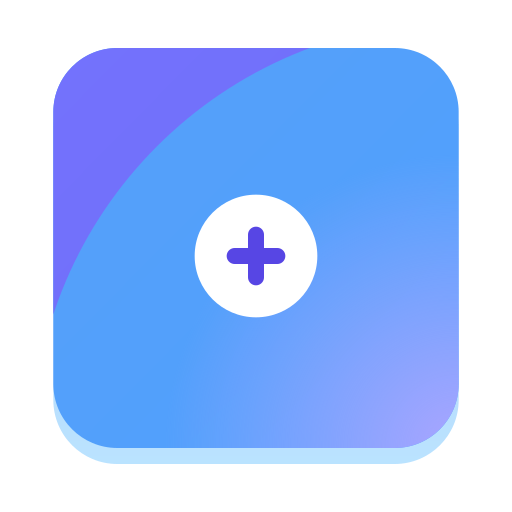
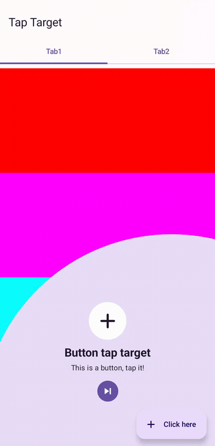
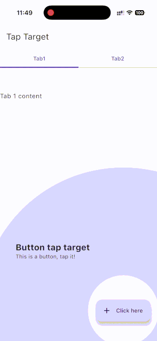

<!-- .github/tap-target-cmp.svg를 프로젝트 아이콘으로 교체하세요. -->
<p align="center">
  
</p>

# tap-target-cmp

Compose Multiplatform으로 구현한 Android·iOS용 애니메이션 기능 안내 오버레이입니다.

[](https://central.sonatype.com/artifact/zone.ien.taptargetcmp/taptarget)
[](LICENSE)

[English](README.md) | **한국어**

<a id="overview"></a>
## 개요

`tap-target-cmp`는 기존 컴포저블을 강조하고 제목과 설명을 표시하여 앱 기능을 안내합니다. 화면을 코디네이터로 감싸고 modifier로 안내 대상을 지정하면, 라이브러리가 표시 순서와 오버레이 애니메이션, 스크롤 요청을 처리합니다.

[tap-target-compose](https://github.com/PierfrancescoSoffritti/tap-target-compose)를 포크하여 Android 전용 구현을 공통 [Compose Multiplatform](https://kotlinlang.org/compose-multiplatform/) 코드로 Android와 iOS에 확장했습니다. [Material Design 기능 탐색 패턴](https://m1.material.io/growth-communications/feature-discovery.html#feature-discovery-design)을 따르며, 아이콘과 안내 건너뛰기를 위한 컴포저블 슬롯을 제공합니다.

<a id="table-of-contents"></a>
## 목차

- [개요](#overview)
- [미리보기](#preview)
- [주요 기능](#features)
- [플랫폼 지원](#platform-support)
- [설치](#installation)
- [빠른 시작](#quick-start)
- [사용 예제](#usage-examples)
  - [정의 재사용과 선택적 타깃](#reusable-definitions-and-optional-targets)
  - [안내 건너뛰기](#skipping-the-tour)
  - [타깃을 보이는 영역으로 스크롤](#scrolling-targets-into-view)
  - [아이콘과 사용자 정의 래퍼](#icons-and-custom-wrappers)
- [API 참조](#api-reference)
  - [TapTargetCoordinator](#taptargetcoordinator)
  - [타깃 modifier와 TapTargetDefinition](#target-modifiers-and-taptargetdefinition)
  - [TextDefinition과 TapTargetStyle](#textdefinition-and-taptargetstyle)
  - [스코프와 상태](#scope-and-state)
- [호환성과 제한 사항](#compatibility-and-limitations)
- [개발](#development)
- [라이선스와 출처](#license-and-attribution)

<a id="preview"></a>
## 미리보기

| Android | iOS |
| --- | --- |
| [](.github/android_demo.mp4) | [](.github/ios_example.gif) |

[Android MP4 재생 또는 다운로드](.github/android_demo.mp4). 현재 소스로 빌드한 샘플을 **Android 17을 실행하는 Pixel 7a 실기기**에서 촬영했습니다. 아이콘 래퍼, 타깃 전환, 자동 스크롤을 보여줍니다. 18초 영상에서 시스템 상태 표시줄과 내비게이션 영역은 제외했습니다. iOS 미리보기는 기존 녹화이며, [이전 Android 녹화](.github/android_example.gif)도 보존했습니다.

[공통 샘플 화면](example/composeApp/src/commonMain/kotlin/zone/ien/taptargetcmp/example/App.kt)에서 툴바, 플로팅 액션 버튼, 탭, 스크롤 영역의 타깃을 확인할 수 있습니다.

<a id="features"></a>
## 주요 기능

- **Android·iOS 공통 구현** — 별도의 네이티브 오버레이 구현 없이 공통 Compose UI 코드에서 기능 안내를 구성합니다.
- **순서가 있는 안내** — 단일 타깃 또는 여러 타깃을 `precedence` 오름차순으로 표시하고, 타깃 변경과 완료 콜백을 제공합니다.
- **원본 타깃 렌더링** — 활성 컴포저블을 그래픽 레이어에 기록하고 애니메이션 오버레이 위에 그려 원래 모양과 윈도 좌표 변환을 유지합니다.
- **재사용 가능한 선택적 정의** — `TapTargetDefinition`으로 타깃을 구성하고, 안내 밖에서도 사용하는 공통 UI에는 [`ifTapTarget`](#target-modifiers-and-taptargetdefinition)을 적용합니다.
- **스크롤 연동** — 활성 타깃을 보이는 영역으로 이동하도록 요청합니다. 코디네이터 기본 오프셋과 타깃별 재정의·비활성화를 지원합니다. [스크롤 예제](#scrolling-targets-into-view)를 참고하세요.
- **표현 방식 조정** — 제목·설명 스타일, 오버레이 색상·불투명도, 벡터 아이콘과 아이콘 래퍼를 설정합니다.
- **컴포저블 건너뛰기 UI** — 직접 구성한 [건너뛰기 버튼](#skipping-the-tour)으로 남은 모든 단계를 종료하고 `onComplete`를 호출합니다.

<a id="platform-support"></a>
## 플랫폼 지원

다음 타깃이 [라이브러리 모듈](taptarget/build.gradle.kts)에 설정되어 있습니다. 이 표는 빌드 타깃을 설명하며 모든 기기에 대한 동작 검증을 의미하지 않습니다.

| 플랫폼 | 지원 상태 | 설명 |
| --- | --- | --- |
| Android | 지원 | `androidLibrary`, 최소 API 29. |
| iOS 기기 | 지원 | `iosArm64`, 공통 Compose 렌더러 사용. |
| Apple silicon iOS 시뮬레이터 | 지원 | `iosSimulatorArm64`, iOS 제스처 테스트 포함. |
| Intel iOS 시뮬레이터 | 미지원 | `iosX64` 타깃 미설정. |
| Desktop JVM | 미지원 | JVM 데스크톱 타깃 미설정. |
| Web (JS / Wasm) | 미지원 | JS·Wasm 타깃 미설정. |

<a id="installation"></a>
## 설치

Maven Central에서 배포를 확인한 버전은 **2.0.1**입니다: [`zone.ien.taptargetcmp:taptarget`](https://central.sonatype.com/artifact/zone.ien.taptargetcmp/taptarget/2.0.1). 저장소의 [버전 카탈로그](gradle/libs.versions.toml) 및 [Central 메타데이터](https://repo.maven.apache.org/maven2/zone/ien/taptargetcmp/taptarget/maven-metadata.xml)와 일치합니다. API 참조는 현재 체크아웃을 기준으로 설명합니다.

`settings.gradle.kts`에 의존성 저장소를 설정합니다.

```kotlin
dependencyResolutionManagement {
    repositories {
        google()
        mavenCentral()
    }
}
```

### 버전 카탈로그

`gradle/libs.versions.toml`에 추가합니다.

```toml
[versions]
taptarget = "2.0.1"

[libraries]
taptarget = { module = "zone.ien.taptargetcmp:taptarget", version.ref = "taptarget" }
```

공유 모듈의 `build.gradle.kts`에 의존성을 추가합니다.

```kotlin
kotlin {
    sourceSets {
        commonMain.dependencies {
            implementation(libs.taptarget)
        }
    }
}
```

### 직접 의존성 선언

대신 `commonMain.dependencies`에 좌표를 직접 선언할 수 있습니다.

```kotlin
implementation("zone.ien.taptargetcmp:taptarget:2.0.1")
```

앱에 Compose Multiplatform과 Android·iOS 타깃이 설정되어 있어야 합니다. 예제는 Material 3 컴포넌트를 사용하므로 소비 측 UI 모듈에도 Material 3를 설정하세요. 저장소 도구 버전과 배포 아티팩트의 의존성 버전은 [호환성](#compatibility-and-limitations)을 참고하세요.

<a id="quick-start"></a>
## 빠른 시작

UI를 `TapTargetCoordinator`로 감싸고 수신자 스코프 안에서 `tapTarget`을 적용합니다. 안내 표시 여부와 완료 후 앱 동작은 호출 측에서 관리합니다.

```kotlin
import androidx.compose.foundation.layout.fillMaxSize
import androidx.compose.material3.Button
import androidx.compose.material3.MaterialTheme
import androidx.compose.material3.Text
import androidx.compose.runtime.Composable
import androidx.compose.runtime.getValue
import androidx.compose.runtime.mutableStateOf
import androidx.compose.runtime.remember
import androidx.compose.runtime.setValue
import androidx.compose.ui.Modifier
import zone.ien.taptargetcmp.TapTargetCoordinator
import zone.ien.taptargetcmp.TapTargetStyle
import zone.ien.taptargetcmp.TextDefinition

@Composable
fun FeatureDiscoveryExample() {
    var showTour by remember { mutableStateOf(true) }

    MaterialTheme {
        TapTargetCoordinator(
            showTapTargets = showTour,
            modifier = Modifier.fillMaxSize(),
            onComplete = { showTour = false },
        ) {
            Button(
                onClick = { /* 앱 동작 */ },
                modifier = Modifier.tapTarget(
                    precedence = 0,
                    title = TextDefinition(
                        text = "Create an item",
                        textStyle = MaterialTheme.typography.titleLarge,
                        color = MaterialTheme.colorScheme.onSecondaryContainer,
                    ),
                    description = TextDefinition(
                        text = "Start here to add your first item.",
                        textStyle = MaterialTheme.typography.bodyMedium,
                        color = MaterialTheme.colorScheme.onSecondaryContainer,
                    ),
                    tapTargetStyle = TapTargetStyle(
                        backgroundColor = MaterialTheme.colorScheme.secondaryContainer,
                        tapTargetHighlightColor = MaterialTheme.colorScheme.onSecondaryContainer,
                    ),
                ),
            ) {
                Text(text = "Create")
            }
        }
    }
}
```

강조 영역을 탭하면 다음 안내로 넘어갑니다. 이때 타깃 정의의 `onTargetClick`을 호출하며, 원래 `Button.onClick`으로 탭을 전달하지는 않습니다. 안내와 함께 앱 동작도 실행하려면 `onTargetClick`을 지정하세요. 서로 다른 우선순위의 타깃을 추가하면 연속 안내를 구성할 수 있습니다.

[전체 샘플](example/composeApp/src/commonMain/kotlin/zone/ien/taptargetcmp/example/App.kt)도 참고하세요.

<a id="usage-examples"></a>
## 사용 예제

다음 예제는 [빠른 시작](#quick-start)의 Compose·라이브러리 import를 바탕으로 하며, 필요한 추가 import를 함께 표시합니다.

<a id="reusable-definitions-and-optional-targets"></a>
### 정의 재사용과 선택적 타깃

코디네이터 스코프 안에서는 `Modifier.tapTarget(definition)`에 정의를 직접 전달할 수 있습니다. `TapTargetScope` 수신자가 없는 재사용 컴포저블에는 최상위 확장 함수 `ifTapTarget`을 사용합니다.

```kotlin
import zone.ien.taptargetcmp.TapTargetDefinition
import zone.ien.taptargetcmp.ifTapTarget

@Composable
fun DiscoverableButton(definition: TapTargetDefinition? = null) {
    Button(
        onClick = { /* 앱 동작 */ },
        modifier = Modifier.ifTapTarget(definition),
    ) {
        Text(text = "Create")
    }
}

@Composable
fun ReusableTargetExample() {
    val definition = TapTargetDefinition(
        precedence = 10,
        title = TextDefinition(text = "Create an item"),
        description = TextDefinition(text = "Use this button to get started."),
    )

    TapTargetCoordinator(showTapTargets = true) {
        DiscoverableButton(definition = definition)
    }
}
```

`ifTapTarget(null)` 또는 코디네이터 밖의 `ifTapTarget(definition)`은 modifier를 변경하지 않습니다. 정의 템플릿을 재사용하더라도 동시에 배치되는 각 타깃에는 고유한 우선순위를 지정하세요.

<a id="skipping-the-tour"></a>
### 안내 건너뛰기

선택적 슬롯은 설명 아래의 `BoxScope`입니다. 전달받은 `onSkip` 콜백을 호출하면 남은 모든 타깃을 건너뛰고 코디네이터의 `onComplete`를 호출합니다. 개별 타깃의 클릭·취소 콜백은 호출하지 않습니다.

```kotlin
import androidx.compose.material3.TextButton
import androidx.compose.ui.Alignment
import zone.ien.taptargetcmp.TapTargetDefinition

@Composable
fun SkippableTour() {
    var showTour by remember { mutableStateOf(true) }
    TapTargetCoordinator(
        showTapTargets = showTour,
        onComplete = { showTour = false },
        skipButton = { onSkip ->
            TextButton(
                onClick = onSkip,
                modifier = Modifier.align(Alignment.Center),
            ) {
                Text(text = "Skip")
            }
        },
    ) {
        DiscoverableButton(
            definition = TapTargetDefinition(
                precedence = 0,
                title = TextDefinition(text = "Create an item"),
                description = TextDefinition(text = "Start your first item here."),
            ),
        )
    }
}
```

렌더러는 건너뛰기 UI에 높이 48.dp의 영역을 할당합니다. 사용자 정의 콘텐츠도 이 높이 안에 배치하세요.

<a id="scrolling-targets-into-view"></a>
### 타깃을 보이는 영역으로 스크롤

다음 코드를 코디네이터 콘텐츠 안에서 사용합니다. 코디네이터의 `bringIntoViewVerticalOffset = 100.dp`로 전체 안내의 기본 오프셋을 지정할 수 있습니다.

```kotlin
import androidx.compose.foundation.layout.Column
import androidx.compose.foundation.layout.Spacer
import androidx.compose.foundation.layout.height
import androidx.compose.foundation.rememberScrollState
import androidx.compose.foundation.verticalScroll
import androidx.compose.ui.unit.dp

Column(modifier = Modifier.verticalScroll(rememberScrollState())) {
    Spacer(modifier = Modifier.height(600.dp))
    Button(
        onClick = { },
        modifier = Modifier.tapTarget(
            precedence = 20,
            title = TextDefinition(text = "More options"),
            description = TextDefinition(text = "This target requests scrolling."),
            bringIntoViewVerticalOffset = 160.dp,
        ),
    ) {
        Text(text = "Options")
    }
}
```

타깃별 오프셋은 코디네이터 기본값보다 우선하며, `null`이면 기본값을 상속합니다. 요청 사각형은 로컬 `y = -offset`에서 시작하므로 양수 오프셋은 타깃 위쪽으로 요청 영역을 확장합니다. 실제 스크롤은 상위 컨테이너의 bring-into-view 처리와 스크롤 가능 범위에 따라 달라지며, 최종 화면 위치를 보장하지 않습니다.

특정 타깃의 자동 스크롤을 끄려면 `bringIntoViewEnabled = false`를 지정합니다. 직접 호출하는 `tapTarget` 오버로드에는 사용자 정의 `BringIntoViewRequester`도 전달할 수 있습니다. `TapTargetDefinition`은 이 매개변수를 제공하지 않습니다.

<a id="icons-and-custom-wrappers"></a>
### 아이콘과 사용자 정의 래퍼

앱의 기존 `ImageVector`를 전달합니다. 이 예제에는 추가 아이콘 의존성이 필요하지 않습니다. 아이콘은 제목 위에 표시되며, `iconWrapper`로 배경이나 장식을 추가할 수 있습니다.

```kotlin
import androidx.compose.foundation.background
import androidx.compose.foundation.layout.Box
import androidx.compose.foundation.layout.size
import androidx.compose.foundation.shape.CircleShape
import androidx.compose.ui.Alignment
import androidx.compose.ui.graphics.Color
import androidx.compose.ui.graphics.vector.ImageVector
import androidx.compose.ui.unit.dp
import zone.ien.taptargetcmp.TapTargetScope

@Composable
fun TapTargetScope.IconTarget(icon: ImageVector) {
    Button(
        onClick = { },
        modifier = Modifier.tapTarget(
            precedence = 30,
            title = TextDefinition(text = "Create something new"),
            description = TextDefinition(text = "This action starts a new item."),
            icon = icon,
            iconWrapper = { content ->
                Box(
                    modifier = Modifier.size(72.dp)
                        .background(Color.White, CircleShape),
                    contentAlignment = Alignment.Center,
                ) {
                    content()
                }
            },
        ),
    ) {
        Text(text = "Create")
    }
}
```

아이콘 크기는 48.dp이며 72.dp 컨테이너 안에 배치됩니다. `tapTargetHighlightColor`는 아이콘 색상에 적용되며 원본 타깃의 색상을 변경하지 않습니다. 래퍼는 `icon`이 null이 아닐 때만 사용합니다. [샘플](example/composeApp/src/commonMain/kotlin/zone/ien/taptargetcmp/example/App.kt)은 플로팅 액션 버튼에 아이콘 래퍼를 적용합니다.

<a id="api-reference"></a>
## API 참조

다음 API는 모두 `zone.ien.taptargetcmp` 패키지에 있습니다. 선언은 [TapTarget.kt](taptarget/src/commonMain/kotlin/zone/ien/taptargetcmp/TapTarget.kt), 오버레이 동작은 [Rendering.kt](taptarget/src/commonMain/kotlin/zone/ien/taptargetcmp/Rendering.kt)를 참고하세요.

### TapTargetCoordinator

| 매개변수 | 타입 | 기본값 | 동작 |
| --- | --- | --- | --- |
| `showTapTargets` | `Boolean` | 필수 | 오버레이 표시 여부를 제어하며 진행 상태는 초기화하지 않습니다. |
| `modifier` | `Modifier` | `Modifier` | 루트 `Box`에 적용합니다. |
| `onComplete` | `() -> Unit` | `{ }` | 마지막 타깃 종료 또는 안내 건너뛰기 시 호출합니다. 동일 상태의 중복 완료 호출을 방지합니다. |
| `onTargetChanged` | `(Int) -> Unit` | `{ }` | 새 활성 타깃의 목록 인덱스가 아닌 우선순위를 전달합니다. |
| `state` | `TapTargetCoordinatorState` | 내부에서 기억하는 상태 | 생성자와 진행 상태 변경은 내부 전용입니다. [상태 제약](#scope-and-state)을 참고하세요. |
| `contentAlignment` | `Alignment` | `Alignment.Center` | 루트 `Box` 안의 콘텐츠 정렬입니다. |
| `bringIntoViewVerticalOffset` | `Dp` | `0.dp` | 타깃의 기본 스크롤 요청 오프셋입니다. |
| `skipButton` | `(@Composable BoxScope.(onSkip: () -> Unit) -> Unit)?` | `null` | 설명 아래에 표시할 사용자 정의 건너뛰기 UI입니다. |
| `content` | `@Composable TapTargetScope.() -> Unit` | 필수 | `tapTarget`을 사용할 수 있는 화면 콘텐츠입니다. |

<a id="target-modifiers-and-taptargetdefinition"></a>
### 타깃 modifier와 TapTargetDefinition

`TapTargetScope`는 `Modifier.tapTarget(title, description, precedence, ...)`와 `Modifier.tapTarget(tapTargetDefinition)` 두 멤버 확장 함수를 제공합니다. 정의의 생성자 매개변수는 다음과 같으며 직접 호출하는 오버로드에서도 사용합니다.

| 매개변수 | 타입 | 기본값 | 동작 |
| --- | --- | --- | --- |
| `title` | `TextDefinition` | 필수 | 제목과 스타일입니다. |
| `description` | `TextDefinition` | 필수 | 설명과 스타일입니다. |
| `precedence` | `Int` | 필수 | 작은 값부터 표시합니다. 코디네이터 안에서 고유해야 합니다. |
| `tapTargetStyle` | `TapTargetStyle` | `TapTargetStyle.Default` | 오버레이와 아이콘 모양입니다. |
| `onTargetClick` | `() -> Unit` | `{ }` | 강조 타깃 원 안의 탭에 호출하며 종료 애니메이션 후 다음 타깃으로 이동합니다. |
| `onTargetCancel` | `() -> Unit` | `{ }` | 바깥 원 외부를 탭하면 종료 애니메이션 후 호출하고 다음 타깃으로 이동합니다. |
| `bringIntoViewEnabled` | `Boolean` | `true` | 활성화 시 자동 bring-into-view 요청을 사용합니다. |
| `bringIntoViewVerticalOffset` | `Dp?` | `null` | null이 아니면 코디네이터의 오프셋을 재정의합니다. |
| `icon` | `ImageVector?` | `null` | 텍스트 위에 표시할 선택적 아이콘입니다. |
| `iconWrapper` | `(@Composable (content: @Composable () -> Unit) -> Unit)?` | `null` | 전달된 아이콘 콘텐츠를 감쌉니다. |

직접 호출하는 오버로드는 `bringIntoViewRequester: BringIntoViewRequester? = null`도 받습니다. 지정하지 않으면 내부에서 requester를 생성하여 기억합니다.

최상위 `Modifier.ifTapTarget(definition: TapTargetDefinition?)`은 `LocalTapTargetScope`로 가장 가까운 코디네이터를 찾습니다. 스코프와 정의가 모두 존재할 때만 적용합니다. [선택적 타깃](#reusable-definitions-and-optional-targets)을 참고하세요.

<a id="textdefinition-and-taptargetstyle"></a>
### TextDefinition과 TapTargetStyle

`TextDefinition`은 명시적으로 전달한 스타일 값을 `textStyle`에 병합합니다. 스타일 프로퍼티 자체는 내부 전용이지만 생성자 인자는 외부에서 전달할 수 있습니다. 최종 `style: TextStyle`과 `text: String`은 공개 프로퍼티입니다.

| `TextDefinition` 매개변수 | 타입 | 기본값 |
| --- | --- | --- |
| `text` | `String` | 필수 |
| `textStyle` | `TextStyle` | `TextStyle.Default` |
| `color` | `Color` | `Color.Unspecified` |
| `fontSize`, `letterSpacing`, `lineHeight` | `TextUnit` | `TextUnit.Unspecified` |
| `fontStyle` | `FontStyle?` | `null` |
| `fontWeight` | `FontWeight?` | `null` |
| `fontFamily` | `FontFamily?` | `null` |
| `textDecoration` | `TextDecoration?` | `null` |
| `textAlign` | `TextAlign?` | `null` |

최종 텍스트 정렬이 지정되지 않으면 렌더러가 가운데 정렬합니다. `textAlign`을 지정하면 해당 정렬을 사용합니다.

| `TapTargetStyle` 프로퍼티 | 타입 | 기본값 | 동작 |
| --- | --- | --- | --- |
| `backgroundColor` | `Color` | `Color.Blue` | 바깥 원의 색상입니다. |
| `backgroundAlpha` | `Float` | `1f` | 바깥 원의 불투명도입니다. 0부터 1 사이의 값을 전달합니다. |
| `tapTargetHighlightColor` | `Color` | `Color.White` | 선택적 아이콘의 색상입니다. |

`TapTargetStyle.Default`는 `TapTargetStyle()`과 같습니다.

<a id="scope-and-state"></a>
### 스코프와 상태

- `TapTargetScope`는 코디네이터에서 제공하며 생성자는 내부 전용입니다. 분리한 화면 함수에는 `TapTargetScope` 수신자를 사용하거나, 선택적 연동에 `ifTapTarget`을 사용하세요.
- `LocalTapTargetScope`는 기본값이 `null`인 공개 `CompositionLocal<TapTargetScope?>`입니다.
- `TapTargetCoordinatorState`의 생성자는 내부 전용이며 `currentTarget: TapTarget?`를 공개합니다. 공개 상태 팩터리, 초기화, 다음 단계, 건너뛰기 메서드는 없습니다. 기본 상태는 코디네이터 내부에서 생성하므로 `state` 매개변수만으로 일반적인 외부 상태 생성 API를 사용할 수는 없습니다.
- `TapTarget`의 생성자는 내부 전용입니다. 공개 프로퍼티는 현재 타깃의 `precedence`, `title`, `description`, `coordinates`, `style`, 클릭·취소 콜백, 스크롤 설정과 requester, `icon`, `iconWrapper`를 제공합니다. 그래픽 레이어 관리 정보는 내부 전용입니다.

<a id="compatibility-and-limitations"></a>
## 호환성과 제한 사항

다음 버전은 **현재 저장소 설정**이며, 모든 이전·이후 소비 측 도구와의 호환성을 보장하지 않습니다. [버전 카탈로그](gradle/libs.versions.toml), [Gradle wrapper](gradle/wrapper/gradle-wrapper.properties), [샘플 설정](example/composeApp/build.gradle.kts)을 참고하세요.

| 구성 요소 | 저장소 설정 |
| --- | --- |
| Kotlin / Compose compiler plugin | 2.4.21 |
| Compose Multiplatform | 1.12.2 |
| Compose Material 3 | 1.12.0-alpha03 (사전 배포 의존성) |
| Android Gradle Plugin | 9.3.1 |
| Gradle wrapper | 9.7.0 |
| Android | minSdk 29, compileSdk 37, 샘플 targetSdk 37 |
| 샘플 Java / JVM 타깃 | 21, 저장소 개발에는 JDK 21 사용 |
| iOS 샘플 배포 타깃 | 18.2, 샘플 설정이며 별도로 선언된 라이브러리 최소 버전은 아님 |

배포된 **2.0.1**의 [POM](https://repo.maven.apache.org/maven2/zone/ien/taptargetcmp/taptarget/2.0.1/taptarget-2.0.1.pom)은 Kotlin stdlib **2.4.21**, Compose preview/resources **1.12.2**, Material 3 **1.12.0-alpha03**을 선언합니다. 현재 체크아웃과 일치하며, 배포 아티팩트를 연동할 때 Material 3의 사전 배포 의존성을 고려하세요.

- **안내 생명주기:** 오버레이를 숨겨도 진행 상태는 유지됩니다. 새 안내를 시작하려면 Compose `key` 변경 등으로 코디네이터의 컴포지션을 다시 생성하세요. 완료 이력은 저장하지 않으므로 최초 실행 여부는 앱에서 보관해야 합니다.
- **표시 여부와 효과:** `showTapTargets`는 그리기를 제어하지만 타깃 변경 콜백과 bring-into-view 효과를 제어하지 않습니다. 숨겨진 코디네이터도 처음 구성될 때 스크롤을 요청할 수 있습니다.
- **타깃 등록:** 레이아웃 후 우선순위를 키로 등록하며, 중복 값은 서로 덮어씁니다. 타깃이 컴포지션에서 사라져도 항목을 명시적으로 제거하지 않으므로 안내 중 타깃 구성을 안정적으로 유지하세요. 아직 컴포즈되지 않은 lazy 항목은 등록되지 않으며 라이브러리만으로 해당 항목까지 스크롤할 수 없습니다.
- **제스처:** 타깃 탭과 바깥 원 외부의 탭은 모두 한 단계 진행합니다. 두 원 사이를 탭하면 동작하지 않습니다. 건너뛰기는 안내 전체를 종료합니다. 포커스를 받는 팝업은 뒤로 가기와 외부 클릭에 의한 자동 닫기를 비활성화합니다.
- **레이아웃:** 위치 계산은 윈도 경계를 사용하며 시스템 바·안전 영역 inset을 별도로 처리하지 않습니다. 긴 텍스트나 큰 사용자 정의 콘텐츠는 가용 영역을 넘을 수 있으므로 edge-to-edge 화면, 글꼴 배율, 기기별 크기를 확인하세요.
- **접근성:** 제목과 설명은 canvas에 그리며 선택적 아이콘에는 콘텐츠 설명이 없습니다. 화면 읽기 semantics와 키보드 안내 탐색을 위한 전용 API는 구현되어 있지 않으므로 앱의 접근성을 검증하세요.

문제는 [GitHub 이슈](https://github.com/ienground/tap-target-cmp/issues)로 제보할 수 있습니다. 새 배포 알림은 [저장소 구독](https://github.com/ienground/tap-target-cmp)으로 받아볼 수 있습니다.

<a id="development"></a>
## 개발

저장소 구성은 다음과 같습니다.

| 경로 | 역할 |
| --- | --- |
| [taptarget](taptarget/) | 라이브러리, 공통 렌더링, 공통 테스트, iOS 제스처 테스트. |
| [example/composeApp](example/composeApp/) | 공통 샘플 UI와 iOS 프레임워크. |
| [example/androidApp](example/androidApp/) | Android 앱 진입점. |
| [example/iosApp](example/iosApp/) | Xcode 샘플 프로젝트. |
| [.github/workflows](.github/workflows/) | CI와 Maven Central 배포 워크플로. |

JDK 21과 플랫폼 37이 설치된 Android SDK를 사용하세요. iOS 빌드·테스트에는 macOS와 Xcode가 필요하며, 설정된 시뮬레이터 타깃에는 Apple silicon이 필요합니다. Android SDK 경로는 로컬 환경이나 `local.properties`로 설정합니다.

저장소 루트에서 실행합니다.

```bash
# 라이브러리 빌드
./gradlew :taptarget:assemble

# Android 호스트에서 공통 테스트 실행
./gradlew :taptarget:testAndroidHostTest

# Apple silicon 시뮬레이터에서 공통 테스트와 iOS 제스처 테스트 실행
./gradlew :taptarget:iosSimulatorArm64Test

# 라이브러리 린트 실행
./gradlew :taptarget:lint

# Android 샘플 빌드
./gradlew :example:androidApp:assembleDebug

# 연결된 Android 기기 또는 에뮬레이터에 설치
./gradlew :example:androidApp:installDebug
```

iOS 샘플은 Xcode에서 [iosApp.xcodeproj](example/iosApp/iosApp.xcodeproj)를 열고, `iosApp` 스킴과 적절한 시뮬레이터 또는 기기를 선택하여 실행합니다. 빌드 단계에서 `:example:composeApp:embedAndSignAppleFrameworkForXcode`를 호출하며, 기기 실행에는 서명 설정이 필요합니다.

기존 테스트는 정의 설정, 건너뛰기 인덱스 계산, 텍스트 배치, 그래픽 레이어 기록 조건·변환, 재배치 중 iOS 탭 처리를 다룹니다. 이 검증은 기기에서의 시각적 확인이나 접근성 검증을 대체하지 않습니다. 현재 [CI 워크플로](.github/workflows/gradle.yml)는 JDK 17을 선택하지만 샘플은 JVM 21을 대상으로 합니다. 워크플로가 존재한다는 사실만으로 현재 도구 버전과의 호환성을 보장할 수는 없습니다.

<a id="license-and-attribution"></a>
## 라이선스와 출처

저장소의 [LICENSE](LICENSE)는 **MIT License**와 **Copyright (c) 2023 Pierfrancesco Soffritti**를 포함합니다. 소프트웨어를 재배포할 때 해당 저작권 고지와 라이선스 본문을 보존하세요.

이 프로젝트는 [Pierfrancesco Soffritti의 tap-target-compose](https://github.com/PierfrancescoSoffritti/tap-target-compose)를 Compose Multiplatform으로 확장한 포크입니다. 원본은 [KeepSafe의 TapTargetView](https://github.com/KeepSafe/TapTargetView)에서 영감을 받은 Android 라이브러리입니다. 이 포크는 Android·iOS 타깃을 설정하고 스크롤 오프셋, 선택적 정의, 아이콘 래퍼, 컴포저블 건너뛰기 슬롯을 포함합니다.

**라이선스 메타데이터 불일치:** 저장소의 [배포 설정](build.gradle.kts)과 배포된 2.0.1 POM은 **Apache-2.0**을 선언하지만, 저장소의 `LICENSE`는 **MIT**입니다. 두 선언이 일치하지 않으므로 유지관리자의 라이선스 의도 확인이 필요합니다. 이 문서는 두 선언을 그대로 설명하며 라이선스 조건을 변경하지 않습니다.
